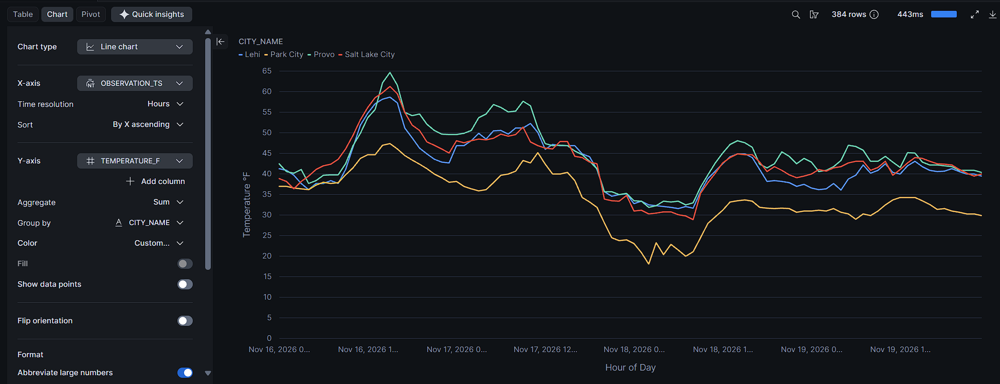
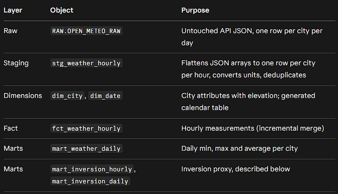
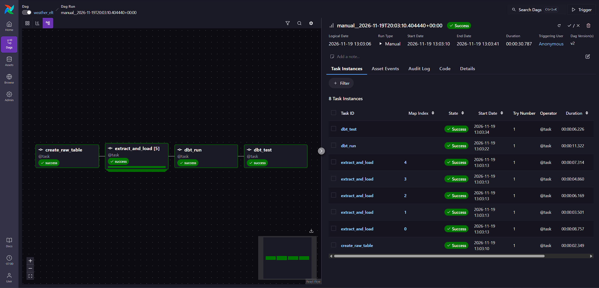
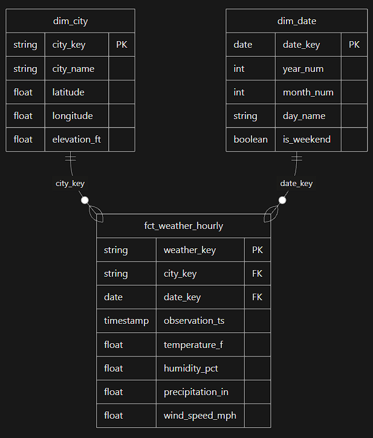

# Utah Weather Inversion ELT Pipeline

A daily ELT pipeline that loads hourly weather data for four Utah cities into Snowflake with **Apache Airflow**, models it into a star schema with **dbt**, and uses it to build a **winter inversion proxy** to see if weather conditions were appropriate for an inversion.

**Stack:** Airflow (Astro CLI, Docker) · Snowflake · dbt · Python · SQL · Open-Meteo API

The graph below shows temperatures for 4 Wasatch cities. If the temperature in Park City (yellow) is ever above the valley temperature, there could be elevated pollution levels in the valley (inversion).
RESULTS: On November 16th this year, there was a mild inversion in the morning. The morning of Nov 17th was another close day.



*When Park City (higher elevation) runs warmer than the valley cities, cold air is trapped on the valley floor: a temperature inversion.*

## What it does

Every day, Airflow pulls hourly weather for Salt Lake City, Provo, Park City, Lehi and St George from the free Open-Meteo API and loads the raw JSON into Snowflake. dbt then flattens it into clean tables, converts units to US customary (°F, mph, inches, feet), builds a star schema and analysis marts, and runs data quality tests. If any test fails, the run fails.

## Architecture



The Airflow DAG creates the raw table if needed, loads one city per task in parallel, then runs `dbt run` followed by `dbt test`:



## Data model



| Layer | Object | Purpose |
|---|---|---|
| Raw | `RAW.OPEN_METEO_RAW` | Untouched API JSON, one row per city per day |
| Staging | `stg_weather_hourly` | Flattens JSON arrays to one row per city per hour, converts units, deduplicates |
| Dimensions | `dim_city`, `dim_date` | City attributes with elevation; generated calendar table |
| Fact | `fct_weather_hourly` | Hourly measurements (incremental merge) |
| Marts | `mart_weather_daily` | Daily min, max and average per city |
| Marts | `mart_inversion_hourly`, `mart_inversion_daily` | Inversion proxy, described below |

## Analysis: Wasatch Front inversion proxy

Winter inversions trap cold air and pollution in Utah's valleys. On a normal day, temperature falls as elevation rises. During an inversion the pattern flips and the mountains are warmer than the valley floor.

The pipeline compares Park City (about 6,700 ft) against the valley cities, Salt Lake City, Provo and Lehi (about 4,500 ft), for the same hour and computes:

- **`is_inversion`**: the higher site is warmer than the valley site.
- **`is_stagnant_inversion`**: an inversion with calm valley wind, meaning less mixing.
- **`lapse_rate_f_per_1000ft`**: temperature change per 1,000 ft of elevation (about -3.6 on a normal day).
- **`is_inversion_day`**: six or more inverted hours in a day.

> **Caveat:** Open-Meteo values are modeled, not station measurements, and weather models smooth terrain, so this is a proxy and not an air quality measurement. A planned next step is to validate it against PM2.5 data.

## Design decisions

- **Raw JSON in a VARIANT column.** The raw layer stays a faithful copy of the source, so an API change cannot break the load. Parsing happens in dbt, where it is versioned and tested.
- **Unit conversion in staging, not at the API.** The raw layer keeps the API's native metric units, and every downstream model inherits the US units from one place.
- **Idempotent loads.** Each city task deletes its rows for the run date and re-inserts them inside one transaction, so reruns and backfills never create duplicates.
- **Dynamic task mapping.** `extract_and_load.expand(city=CITIES)` creates one task per city at runtime. Adding a city is a one-line change.
- **Incremental fact table.** `fct_weather_hourly` merges on a surrogate key and only processes newly loaded rows.
- **Key-pair authentication and least privilege.** The pipeline runs as a Snowflake service user with a dedicated role that can only touch one database. No passwords are stored anywhere.
- **dbt in an isolated virtualenv** inside the Airflow image, to avoid dependency conflicts with Airflow.
- **Tests on every layer:** not-null, unique and relationship tests, plus custom tests for implausible temperatures and lapse rates.

## Run it yourself

**Prerequisites:** Windows with WSL 2 and Docker Desktop, the [Astro CLI](https://www.astronomer.io/docs/astro/cli/install-cli), Git (for Git Bash and OpenSSL), and a free [Snowflake trial](https://signup.snowflake.com).

1. **Clone the repo**
   ```bash
   git clone https://github.com/itskylesmyle/Weather-ELT-Pipeline-Project.git
   cd Weather-ELT-Pipeline-Project
   ```

2. **Set up Snowflake.** In a worksheet as `ACCOUNTADMIN`, create a warehouse `WEATHER_WH`, a database `WEATHER_DB` with schemas `RAW` and `ANALYTICS`, a role `WEATHER_ROLE` with privileges on them, and a user `AIRFLOW_USER` of `TYPE = SERVICE` with your public key registered.

3. **Generate a key pair** in Git Bash:
   ```bash
   openssl genrsa 2048 | openssl pkcs8 -topk8 -inform PEM -out rsa_key.p8 -nocrypt
   openssl rsa -in rsa_key.p8 -pubout -out rsa_key.pub
   ```
   Register the public key on `AIRFLOW_USER`, then copy `rsa_key.p8` to `include/keys/rsa_key.p8`. This folder is git-ignored. **Never commit the private key.**

4. **Configure environment variables.** Copy `.env.example` to `.env` and fill in your Snowflake account identifier:
   ```bash
   cp .env.example .env
   ```

5. **Start Airflow**
   ```bash
   astro dev start
   ```
   Open http://localhost:8080, find the `weather_elt` DAG and switch it on. With `catchup=True`, it backfills one run per day since the DAG's `start_date`.

6. **Query the results** in Snowflake, for example:
   ```sql
   SELECT * FROM WEATHER_DB.ANALYTICS.MART_WEATHER_DAILY
   ORDER BY DATE_KEY DESC, CITY_NAME;
   ```

## Project structure

```text
.
├── dags/
│   └── weather_elt.py            # Airflow DAG: extract, load, dbt run, dbt test
├── include/
│   └── dbt/weather_dbt/
│       ├── models/
│       │   ├── staging/          # sources.yml, stg_weather_hourly.sql
│       │   ├── marts/            # dimensions, fact, daily and inversion marts
│       │   └── schema.yml        # generic tests
│       ├── tests/                # custom data quality tests
│       ├── dbt_project.yml
│       └── profiles.yml          # reads credentials from environment variables
├── docs/images/                  # README diagrams and screenshots
├── tests/dags/                   # DAG integrity test
├── Dockerfile                    # Astro image plus dbt in its own virtualenv
├── requirements.txt
└── .env.example
```

## Limitations and next steps

- Only a short history is loaded, so seasonal conclusions are limited. Next step: backfill several winters from Open-Meteo's archive API.
- Inversion detection uses modeled temperatures. Next step: validate against PM2.5 from an air quality source.
- Airflow runs locally in Docker. Next step: deploy to a managed environment.
- Credentials come from environment variables. A secrets backend would be the production approach.
- No CI yet. Next step: GitHub Actions running SQL linting and `dbt parse` on every pull request.
- Add a Streamlit dashboard on top of the marts.

## Data source

Weather data from [Open-Meteo](https://open-meteo.com), used under their free non-commercial terms.
